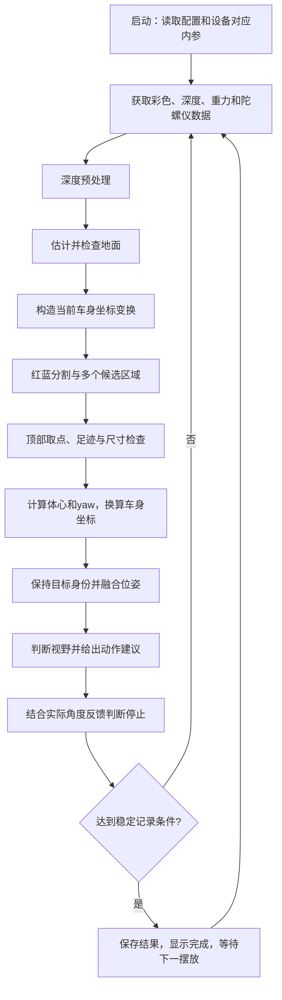
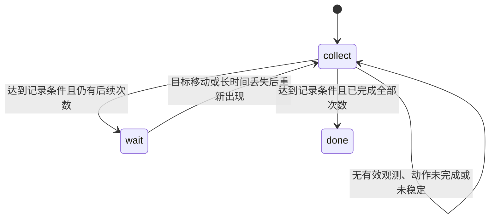

# 方块位姿测量：代码整体逻辑、实现方法与未来改进

更新日期：2026-11-17。本文依据当前 robocon1 代码整理，介绍整体设计，配合《答辩思路_问题导向.md》使用：那份文档解释开发中遇到什么问题，本篇解释程序怎样完成工作、各部分为什么这样组织，以及后续可怎样改进。

## 1. 项目整体做什么

输入是 D435i 的彩色图、对齐深度图以及 IMU 数据；处理对象是边长0.20 m、上下红蓝分色的地面方块。程序识别目标，计算体心位置和水平转角，判断观察条件与测量稳定性，最终记录本次摆放的 x、y、yaw。

当前实机输出以**当前小车右前点**为原点，X向车右、Y向车前、Z向上。位置单位为米，yaw单位为弧度。正方形每90°具有几何对称性，yaw折返到约±45°。

实现采用Python、NumPy、OpenCV、pyrealsense2和YAML配置，主路径使用颜色与几何方法，没有依赖训练好的神经网络检测器。选择这种方法适合目标颜色、边长与落地条件明确的场景，便于解释和排查；其适用范围也受这些先验约束。

## 2. 大体运行流程

这是职责示意。没有地面、姿态无效或候选不合格时，不生成新的位姿，但主循环仍可判断失败原因、显示状态并规划观察动作。

代码可以理解为两条相互配合的路径：一条负责“测到什么”，另一条负责“现在该怎么观察、什么时候可以记录”。动作建议不会被当成方块位姿送进融合。

## 3. 文件和模块怎样分工

| 模块 | 主要职责 | 交给下一步的内容 |
| --- | --- | --- |
| main.py | 解析参数，组织实机循环，连接测量、反馈和记录 | 画面、状态提示和正式结果 |
| config/ | 保存内参、目标尺寸、HSV、光照档位和稳定门限 | 运行参数 |
| camera/source.py | 相机取流、对齐、IMU坐标转换、缓存与深度预处理 | Frame及有效深度 |
| geom/transform.py | 投影、反投影、坐标变换、角度折返 | 三维点与方向 |
| ground/plane.py | 重力约束地面估计及旧平面有效性检查 | 地面法向和偏移 |
| field/body.py | 按当前重力和安装尺寸构造车身变换 | 旋转矩阵R、平移t |
| cube/detect.py | 颜色分割、候选区域、顶部取点、足迹和yaw | 单帧候选位姿及掩膜 |
| cube/rival.py | 在多个合格候选中保持同一个目标 | 本帧选中目标 |
| cube/aim.py | 判断贴边、缺失及足迹失败，规划观察动作 | 俯仰、转向建议和原因 |
| angle_feedback.py | 保存已发目标并用IMU确认执行情况 | 剩余动作、到位或停止状态 |
| fuse/median.py | 中值融合、离群剔除、周期角处理；还保留旧评分函数 | 融合位姿 |
| fuse/trial.py | 管理收集、稳定提交、等待下一摆放、结束 | 正式测量记录 |
| view_cube_center.py | 单独查看轮廓、足迹和体心，方便调试 | 调试画面 |
| sim/、tests/ | 合成场景与回归验证 | 功能检查结果 |

field/extrinsic.py、field/motion.py等保留早期场地定位与运动跟踪能力；当前普通实机主循环没有用它们维护起步世界位置。cube/face_fallback.py是可选补救模块，默认配置关闭，不属于默认识别方法。

## 4. 各阶段采用什么方法

### 4.1 启动和配置

main()读取命令行参数与默认配置。内参可以从相机序列号对应的配置中选择，也可以通过 --intrinsics 指定。颜色、地面门限、稳定帧数等由YAML提供，减少反复改源码。

--self-check进入合成自检；--calibrate-color采集颜色信息后保存HSV；--calibrate保留场地边外参标定分支。这些分支与普通实机识别不同。当前 --mode basic 和 --mode field 在普通实机循环中采用相同的当前车身坐标定义。

### 4.2 采集与深度预处理

RealSenseSource把深度对齐到彩色图，提供重力方向和陀螺仪样本。IMU方向转换到彩色相机坐标中，以便和图像几何计算一致。

深度先保留配置工作范围，默认0.3–3.0 m；再去除明显飞点，进行3×3中值平滑。实机采集端还使用时间滤波。当前没有把大面积空洞填充当作测量依据，避免把背景深度补进方块边缘。

彩色曝光、增益和亮度按档位设置，白平衡等保持锁定，以降低采集条件变化对颜色分割的影响。

### 4.3 地面估计

从深度反投影点云，用重力的反方向作为向上先验，结合RANSAC寻找符合条件的平面。候选法向需满足倾角限制；空间格子权重降低近处密集像素的影响，较低平面优先作为地面候选。

平面可在有效性检查后沿用，减少重复估计；相机转动等情况下应丢弃旧基准。方块附近还有地面环带检查，用来判断公共地面是否确实贴合目标周围。

这里建立的是高度与足迹的参考平面，并不另行拟合一个方块顶面来完成默认检测。

### 4.4 颜色分割与候选区域

将彩色图转为HSV，分别提取红色两个色相区间与蓝色区间。严格颜色提供主要种子，较宽松颜色用于局部接缝补全；结合离地高度约束排除大面积同色地面。

先在半分辨率寻找候选，再回到原分辨率局部细化。半分辨率是定位手段，最终不应仅依赖放大的粗轮廓。缩放、裁剪图像时，内参焦距和主点也随之调整。

保留多个候选有利于后续几何验证，避免一次粗定位错误就锁死整个流程。

### 4.5 从顶部点计算足迹、体心和yaw

颜色掩膜包含完整可见外观，但不是所有点都用于测量。

1. 检查有效点数与相对地面高度，排除明显异常点。
2. 在高于半个边长的点中估计高度峰值，取接近峰值的顶部薄层。
3. 将顶部深度点投影到地面，求最小外接矩形，得到足迹中心和棱方向。
4. 另外计算射线与离地一个边长平面的交点，并用实测深度检查一致性，再求另一套足迹。
5. 两套合格足迹中心差超过2 cm时拒绝该帧；射线足迹有效时优先采用，否则考虑深度足迹。
6. 检查足迹面积、长边和短边，避免线材、残缺区域或大背景通过。
7. 底面中心沿地面法向抬高0.10 m得到体心；棱方向给出yaw。

射线方法利用已知高度减少部分深度误差影响，但仍依赖有效深度筛选，不等于完全不需要方块深度。

### 4.6 换算到当前车身坐标

field/body.py根据本帧重力建立向上方向，并结合相机安装方向构造车身轴。用安装光心偏移确定右前点与光心之间的平移关系。

代码使用的外参约定为：

    p_camera = R · p_body + t
    p_body = Rᵀ · (p_camera − t)

位置需要旋转和平移，方向向量只需要旋转。相机水平安装光心位置当前配置为[-0.211, 0.05, 0.675] m，俯仰转轴到光心偏移可配置。

此方法假设车身在水平地面，相机偏航安装与车头一致。重力无法给出独立偏航云台角度；缺少有效重力和本帧地面法向时，车身变换拒绝生成新坐标。

### 4.7 候选保持和位姿融合

RivalPicker优先保持稳定位置附近的目标，避免绿框在方块与杂物之间逐帧切换。最多处理3个不同位置的合格候选，使用距离关联和连续缺席条件决定是否切换。

选中目标后，位置用中值融合，离群帧用绝对中位差MAD筛除。yaw先按90°周期展开，再处理离群和融合，最后折回输出范围。

短时缺失时主循环可能保留上一次显示结果，但旧结果不会作为新观测提交给TrialSession。显示连续性与正式记录的新鲜度分别管理。

### 4.8 观察动作和实际反馈

cube/aim.py判断目标是否贴边、是否连续丢失、地面是否缺失，以及轮廓稳定但足迹失败等情形，给出俯仰和原地转向建议。已经选中目标时，瞄准使用该目标掩膜。

angle_feedback.py保存已发出的固定角度目标，用重力估计俯仰、用陀螺仪积分核对旋转。进入±3°范围后提示停止并保持1秒；反馈缺失时不报告已到位。

当前由操作者执行动作，代码负责建议与反馈判断。陀螺仪缓存按图像时间戳消费，避免低图像处理帧率下漏掉中间旋转样本。

### 4.9 稳定记录与输出

TrialSession使用以下状态组织一次测量：

当前默认观察至少15秒，最近15帧位置相对中值偏差不超过1 cm，yaw标准差不超过1.5°，同时检查动作是否阻止提交。15帧代表样本数量，真实时间取决于实际处理速度。

提交后写入结果文件，终端显示坐标和识别完成提示，停止进一步瞄准并等待下一摆放。默认记录3次。

内部单帧与融合结果包含z等信息，但正式TrialRecord文件主要保存 x_m、y_m、yaw_rad；不能把内部数据结构描述成每帧持续输出的正式接口。

## 5. 代码设计可以怎样概括

- **先验约束明确：** 用已知颜色、边长和贴地条件缩小求解范围。
- **检测与测量分工：** 完整掩膜服务候选与观察，顶部可信点服务精确几何。
- **空间与时间检查结合：** 尺寸检查限制单帧错误，候选保持和融合限制跨帧跳动。
- **先验证再输出：** 检测可以拒绝，姿态可以无效，正式记录要等稳定条件满足。
- **测量与观察协同：** 不足的观测通过动作建议恢复，并用反馈确认执行。

代价是规则与状态较多，参数之间相互影响。目前main.py承担的协调工作较重，后续既要改善算法，也要整理状态和接口。

## 6. 未来可行的改进方向

以下是基于当前实现提出的后续建议，尚未在本次工作中实施。优先级考虑对测量可信度的影响，而不只追求检出率。

| 优先级 | 改进方向 | 大体方法 | 验证效果的方式 |
| --- | --- | --- | --- |
| P0 | 统一坐标、真值与评分 | 明确当前右前点基准；修订旧测试表与评分函数；报告绝对误差 | 同一组数据按统一口径重算，无原点混用 |
| P0 | 实测安装参数 | 测量光心与右前点关系、转轴偏移及安装偏航 | 同一静止目标在多种俯仰下位置一致 |
| P1 | 建立实机离线回放 | 保存带时间戳的彩色、深度、IMU、配置和真值 | 修改前后重放同一数据，比较误差和拒绝比例 |
| P1 | 输出质量与数据新鲜度 | 明确新测量、短时保持、无效、正式提交；附带观测年龄 | 目标遮挡或移动后能及时区分旧值与新值 |
| P1 | 分阶段性能分析 | 记录采集、地面、分割、几何、显示耗时，再优化最慢部分 | 同时比较处理帧率、延迟和误差 |
| P2 | 抗反光与光照适应 | 对目标附近高光局部处理，持续过曝时缓慢调整曝光 | 对比不同灯光下轮廓完整度、有效深度和位置误差 |
| P2 | 距离相关取点门限 | 实测深度误差后调整顶部层厚和边缘门限，保留上限 | 近处不退步，远处有效率提高且误差不扩大 |
| P2 | 更稳健的方形几何估计 | 在可信顶部点上尝试边线或已知边长方形拟合，与当前矩形比较 | 残缺、偏斜样例中中心与yaw更准确 |
| P2 | 整理状态与模块接口 | 分离观测、检测、目标保持、动作和会话；定义统一数据结构 | 回放及现有回归行为一致，状态转换更易检查 |
| P3 | 接入自动执行机构 | 对接俯仰/转向控制与真实反馈，保留动作约束和停止逻辑 | 固定测试集完成时间和成功率改善 |
| P3 | 扩展目标或复杂场景 | 需要时引入学习型候选检测，几何尺度检查仍保留 | 新环境召回率提升，三维误差与误检可控 |

### 6.1 优先解决系统偏差

中值能减少抖动，但不能修正错误安装尺寸或错误坐标原点。因此先做安装与真值统一，再调整滤波。转轴偏移默认零属于当前近似，应通过实测判断影响。

### 6.2 性能优化先有耗时证据

可以优先评估减少重复颜色转换、复用候选掩膜、降低非必要绘图频率、在稳定时减少地面重新拟合等做法。如果拆分采集与计算线程，应保证图像、重力和陀螺仪时间一致，并处理排队延迟；多线程本身不保证测量更快或更准。

当前已具备半分辨率定位与局部细化，不应再将其列为尚未实现的优化。

### 6.3 深度缺失不能靠无条件补洞

抗反光和远距改进应先区分颜色缺失、深度缺失、地面错误及视角不足。放宽顶部层会增加侧面混入风险，填洞会引入背景深度；任何替代几何方法都需明确适用条件和拒绝条件。

未来如要实现少深度甚至无深度的模型拟合，应作为独立方法验证，不能直接等同于当前射线方案。

### 6.4 重构围绕真实职责

建议把run_live拆成“构建本帧观测→估计目标→更新目标历史→规划并确认动作→更新测量会话→显示与保存”。保持默认输出与行为，再逐步引入更清晰的结构，避免一次重写全部算法。

历史场地定位与当前车身定位也可明确标识使用范围，减少basic、field名称与实际行为之间的误解。

## 7. 建议的改进顺序

1. 统一测量定义，实测安装参数，收集一组可信的实机基准数据。
2. 建立回放与误差统计，补充阶段耗时和数据新鲜度记录。
3. 根据真实失败占比选择抗反光、远距或几何拟合改进，每次只比较一个主要变化。
4. 行为稳定后整理主循环和数据接口，再考虑自动执行与目标扩展。

每次改进至少比较位置绝对误差、yaw周期角误差、有效输出比例和完成时间。更容易输出但误差变大，不应直接视为改进成功。

## 8. 答辩时的一分钟代码逻辑说明

“程序先从D435i读取彩色、深度和IMU，做深度预处理并建立地面基准。然后用红蓝颜色和离地高度寻找多个候选，在顶部可信点上计算足迹，通过尺寸与几何一致性检查后得到体心和转角。坐标根据本帧重力和安装尺寸换算到当前车身右前点，再通过候选保持、周期角处理和中值融合提高连续性。如果视野不充分，程序给操作者俯仰或转向建议，并根据IMU判断是否到位。最后只有达到稳定和观察时间条件才记录结果。后续优先补实机基准与回放，用数据决定哪些算法值得继续改进。”

## 9. 验证与参考

上一轮全量回归为111项通过，覆盖坐标、候选、融合、角度反馈、会话和无窗口运行。本次仅新增说明文档，未修改算法，也未重新运行测试。

阅读代码可按 main.py的main/run_live → camera/source.py → ground/plane.py → cube/detect.py → field/body.py → cube/rival.py → fuse/median.py → cube/aim.py/angle_feedback.py → fuse/trial.py 的顺序。

开发问题和方案变化详见《答辩思路_问题导向.md》；最新坐标定义详见《右前点坐标说明.md》。旧《技术文档.md》《优化方向.md》含历史设计，阅读时以当前代码核对。
